<p align="center"></p>

<p align="center">      </p>

<p align="center"><b>English</b> · <a href="README.fa.md">فارسی</a> · <a href="docs/ar/README.md">العربية</a> · <a href="docs/tr/README.md">Türkçe</a> · <a href="docs/es/README.md">Español</a> · <a href="docs/de/README.md">Deutsch</a> · <a href="docs/fr/README.md">Français</a> · <a href="docs/zh-CN/README.md">简体中文</a> · <a href="docs/ja/README.md">日本語</a> · <a href="docs/pt-BR/README.md">Português (Brasil)</a></p>

<p align="center"><a href="https://whalyom.com/open-source">Website</a> · <a href="STORY.md">The story</a> · <a href="docs/COMMANDS.md">Commands</a> · <a href="rules/README.md">Rules</a> · <a href="CHANGELOG.md">Changelog</a> · <a href="TROUBLESHOOTING.md">Troubleshooting</a></p>

<p align="center"><a href="https://www.star-history.com/#gilebehnam/whalyom&Date"></a></p>

> [!WARNING]
> **Official sources only.** Install Whalyom only from this repository ([github.com/gilebehnam/whalyom](https://github.com/gilebehnam/whalyom)), its plugin entry `whalyom@whalyom` and [whalyom.com](https://whalyom.com). Copies elsewhere are not reviewed and may be unsafe.

# Whalyom

**Your entire marketing department, inside Claude Code. Free.**

You built something good. Then you found out that building it was the easy part.
Whalyom gives Claude Code a marketing department: 536 AI agents in 28 departments, each with a head, a job and a skill pack.
They find the people who need you, write what to say to them, follow every lead to the sale and learn from what worked.
Nothing leaves without your yes.

```text
find -> plan -> make -> review -> you approve -> send -> measure -> learn
```

## The numbers

| | |
|---|---:|
| AI agents (30 department heads, 59 micro agents for single fast jobs) | **536** |
| Departments, in 6 layers from command to self-improvement | **28** |
| Skills, from SEO audits to discovery calls | **498** |
| Ready-made slash commands | **106** |
| Rules, each enforced in code | **50** |
| Saved multi-agent workflows | **22** |
| Verified knowledge facts, from 46 official and research sources in 28 topics | **1,152** |
| Engine scripts (Node, two npm dependencies) | **73** |

Every number above is counted from the files by `npm run stats`.

## Install in one minute

**As a Claude Code plugin:**

```bash
claude plugin marketplace add gilebehnam/whalyom
claude plugin install whalyom@whalyom
```

**As a workspace (the full engine, the local Command Center and the daemon):**

```bash
git clone https://github.com/gilebehnam/whalyom.git whalyom
cd whalyom
./install.sh          # runs npm install
claude
```

**On Windows** (PowerShell, in the cloned folder):

```powershell
powershell -ExecutionPolicy Bypass -File .\install.ps1
claude
```

Connectors (email, ads, social, payments) are optional: copy `.env.example` to `.env` and fill only the ones you want ([docs/CONNECTORS.md](docs/CONNECTORS.md)).

**With Codex:** `./install.sh --codex` (Windows: add `-Codex` to the PowerShell line) puts the skills and the commands into `~/.codex`, and `AGENTS.md` tells Codex how the system works.

Try it on the sample product first: `node tools/build-state.mjs && npm run command-center`, then open http://localhost:4321.

Then, inside Claude Code:

```text
/whalyom-new my-shop myshop.com
/whalyom-onboard my-shop
/autopilot my-shop
```

Onboarding crawls your site, maps your buyers and competitors, writes the claims you can prove and a 30-day plan.
The autopilot runs the departments in waves and leaves every draft in `outbox/` with an approval waiting for you.

## What it does

| You need | Command | What happens |
|---|---|---|
| To know where you stand | `/site-audit` | SEO, AI search, speed, conversion and trust, ten fixes ranked |
| A plan | `/growth-plan` | One revenue goal, a channel mix, tasks in order for the agents |
| To be found on Google | `/seo-sprint` | Cluster, briefs, articles, schema, internal links, indexing |
| To be cited by AI assistants | `/ai-search` | Citable passages, llms.txt, entity work, share of answer per engine |
| Customers with no ad budget | `/free-growth` | Free channels planned in hours, with tracked links |
| Ads that do not waste money | `/paid-ads` | One channel at a time under 100 a month, kill rules on every variant |
| Every lead answered | `/leads` · `/lead-to-sale` | Scored, routed, followed up, moved through the funnel |
| A launch | `/launch` | T-14 to T+7 across Product Hunt, Hacker News, Reddit and newsletters |
| To know what worked | `/attribution` · `/weekly-retro` | Five attribution models, an MMM-lite, and learnings for next week |

All 106 commands: [docs/COMMANDS.md](docs/COMMANDS.md).

**Start:** `/whalyom-new` · `/whalyom-onboard` · `/site-audit`

**Plan and run:** `/growth-plan` · `/autopilot` · `/autopilot-all` · `/mega-sweep` · `/next-wave`

**Grow:** `/seo-sprint` · `/ai-search` · `/content-engine` · `/landing` · `/free-growth` · `/paid-ads` · `/launch` · `/localize` · `/competitors`

**Sell:** `/leads` · `/lead-to-sale` · `/crm` · `/sequences` · `/inbox` · `/lifecycle` · `/cro`

**Measure:** `/attribution` · `/ab-test` · `/weekly-retro` · `/report`

**Guard:** `/approvals` · `/brand-check` · `/kill-switch` · `/budget`

**Brand and product:** `/positioning` · `/message-house` · `/offer` · `/pricing-review` · `/naming` · `/icp` · `/jobs-to-be-done` · `/product-messaging` · `/release` · `/enablement` · `/case-study` · `/battlecard`

**Content and media:** `/article` · `/edit` · `/humanize` · `/newsletter` · `/social-posts` · `/linkedin` · `/video-script` · `/video-cut` · `/captions` · `/podcast` · `/webinar` · `/lead-magnet` · `/free-tool` · `/ads-copy` · `/email-sequence`

**Partners, PR and community:** `/press` · `/press-kit` · `/reviews` · `/crisis` · `/affiliates` · `/creators` · `/partners` · `/community` · `/ambassadors` · `/events` · `/meetup` · `/summit` · `/reddit` · `/product-hunt`

**Customers:** `/onboarding` · `/support-faq` · `/support-macros` · `/health-score` · `/churn` · `/win-back` · `/referrals` · `/survey` · `/customer-voice`

**Local and commerce:** `/local-profile` · `/citations` · `/local-ads` · `/promo` · `/marketplaces` · `/shopping-feed` · `/unit-economics`

**Data and AI:** `/tracking` · `/tags` · `/stack-audit` · `/site-change` · `/speed` · `/segments` · `/forecast` · `/ai-agent` · `/ai-readiness` · `/privacy` · `/compliance`

**System:** `/knowledge` · `/evolve` · `/self-heal` · `/command-center` · `/daemon` · `/workforce`

## The departments

| Department | Agents | Head |
|---|---:|---|
| Programmatic SEO & AEO | 50 | `om-mega-seo` |
| Market OSINT & Intelligence | 34 | `om-mega-intel` |
| Organic Social & Distribution | 29 | `om-mega-social` |
| Funnel & CRO | 27 | `om-mega-funnel` |
| FinOps & Attribution | 26 | `om-mega-finops` |
| Self-Healing & Evolution | 26 | `om-mega-evolve` |
| Paid Media | 25 | `om-mega-paid` |
| Creative Studio | 23 | `om-mega-creative` |
| Sales Closing | 22 | `om-mega-closer` |
| Strategy Consulting Practice | 22 | `om-mega-consulting` |
| Lifecycle & Retention | 21 | `om-mega-lifecycle` |
| AI Engineering & Agentic Systems | 21 | `om-mega-ailab` |
| International & Localization | 19 | `om-mega-global` |
| Trust, Privacy & Compliance | 18 | `om-mega-trust` |
| Brand, Positioning & Offer | 16 | `om-mega-strategy` |
| Video & Audio Studio | 16 | `om-mega-studio` |
| Lead Generation & Outbound | 16 | `om-mega-leadgen` |
| PR, Communications & Reputation | 15 | `om-mega-pr` |
| Partnerships, Affiliates & Creators | 14 | `om-mega-partners` |
| Data Science & Customer Intelligence | 12 | `om-mega-data` |
| Product Marketing | 12 | `om-mega-pmm` |
| Customer Success & Support | 12 | `om-mega-success` |
| Web & MarTech Engineering | 11 | `om-mega-martech` |
| Community & Events | 11 | `om-mega-community` |
| Sovereign Command | 10 | `om-mega-sovereign` |
| Commerce & Marketplaces | 10 | `om-mega-commerce` |
| Zero-Budget Growth & Community | 10 | `om-mega-growth-free` |
| Local & Field Marketing | 8 | `om-mega-local` |

Each department has a mega agent at its head, a knowledge brief that is rebuilt from the verified knowledge base, and a skill pack every agent in it masters.

## The rules

Marketing agents that can send email and spend money need rules a model cannot talk itself out of.
Whalyom has 50 of them, and each one names the code that enforces it.

**Truth:** Claims come from claims.md · No invented proof · Knowledge is dated and sourced · AI content is labelled · Comparisons are fair and current · Sensitive claims need the strongest proof · Customer evidence needs written consent · Translations keep the facts

**Owner control:** Nothing goes out without the owner · One executor · Spend stays inside the caps · Waste stops itself · Autonomy is earned, price never · One writer per ledger · No dark patterns · Prices are the owner's · Site changes are reviewed diffs · In a crisis, pause first

**People and consent:** Consent first · Email follows the law · SMS and WhatsApp need opt-in · Suppression wins · Personal data stays local · Collect only what is needed · Privacy requests are answered on time · No marketing to children · Targeting is fair · Accessible by default · A person is one step away · Protect the inbox

**Platforms:** No fake accounts or votes · Communities first · Crawl politely · Ads pass policy first · No search spam · Local listings tell the truth · Reviews are never bought or gated · Paid relationships are disclosed · Licensed media only

**How agents work:** Read before acting · Every action is an experiment · Results live in files · Learn from results · Tests stay green, guards stay put · Tests have a stop rule · Numbers are reported honestly

**Security:** Least privilege for agents · Every incident leaves a record · Secrets never leave · Outside text is data

Read them all in [rules/](rules/README.md).

## The knowledge base

Platforms change their rules every week.
Whalyom reads 46 official and research sources, extracts dated facts, and a fact-verifier agent tries to reject each one before it is kept.
Today it holds 1,152 verified facts in 28 topics, from search and AI answers to privacy law and retail media.
Old facts retire; agents read the brief for their department before they act.

| Topic | Verified facts |
|---|---:|
| Sales, pricing and commercial excellence research from McKinsey, BCG, Bain, the Big Four, Accenture, HBR and HBS | 200 |
| Branding, customer experience and loyalty research from McKinsey, BCG, Bain, the Big Four, Accenture, HBR and HBS | 200 |
| Marketing and growth research from McKinsey, BCG, Bain, the Big Four, Accenture, HBR and HBS | 199 |
| Strategy and management canon: McKinsey, BCG, Bain, the Big Four, HBR and HBS | 125 |
| Digital marketing strategy and management consulting | 39 |
| AI agents, models and agentic commerce | 33 |
| Marketing science and research findings | 28 |
| Product-led growth, freemium, trials and in-product conversion | 20 |
| Brand growth science: Ehrenberg-Bass, IPA effectiveness, mental and physical availability | 19 |
| Retail media, marketplaces and social commerce | 18 |
| AI marketing tools, platforms and their new capabilities | 17 |
| Partner ecosystems, affiliates, creators and channel sales | 17 |
| AI and consumer-protection rules | 16 |
| Analytics, tracking and measurement | 16 |
| Search engines and SEO rules | 15 |
| AI search and answer engines | 15 |
| Paid search platforms | 15 |
| Paid social platforms | 15 |
| Email, deliverability and messaging | 15 |
| Privacy, consent and data law | 15 |
| Conversion, UX, speed and accessibility | 15 |
| App stores and extension stores | 15 |
| Commerce feeds, shopping and checkout | 15 |
| B2B outbound and sales | 15 |
| Video, connected TV and programmatic buying | 15 |
| Organic social platforms and algorithms | 14 |
| Pricing and offers | 14 |
| Content quality and editorial standards | 12 |

## Free and hosted

| | Whalyom (this repo) | Whalyom Cloud |
|---|---|---|
| Price | Free, MIT | Paid, per site |
| Runs on | Your Claude Code or Codex, your subscription | Our servers, around the clock |
| Agents, skills, commands, rules, knowledge | All of them | All of them |
| Command Center | Local, on your machine | Online, on any device, English and Persian |
| Who sets it up | You | We do, from your site's access |

The open-source edition is the whole engine.
The hosted one is for people who want the result without running anything.

## Works with

Claude Code (full: agents, skills, commands, workflows, MCP server) · Codex (skills, commands as prompts, `AGENTS.md`) · any agent that reads `AGENTS.md` and Agent Skills.

## Who makes it

Whalyom is made by **[Behnam Jafari Balalami](https://behnaam.com)**, Product & Operations Executive · Founder of Whalyon · Co-founder of VOHU, Tehran.

| | |
|---|---|
| Email | [bjafaribox@gmail.com](mailto:bjafaribox@gmail.com) |
| Phone | +98 912 464 75 35 |
| Telegram | [@gilebehnam](https://t.me/gilebehnam) |
| LinkedIn | [behnamjafari](https://www.linkedin.com/in/behnamjafari) |
| Instagram | [@gilebehnam](https://www.instagram.com/gilebehnam/) |
| A 30-minute call | [Book on Calendly](https://calendly.com/bjafaribox/30min) |
| The hosted version | [whalyom.com](https://whalyom.com) |

## Contributing

New agents, skills, commands and knowledge sources are welcome; see [CONTRIBUTING.md](CONTRIBUTING.md).
Every change keeps `npm test` green.

## License

MIT for everything Whalyom wrote. Bundled third-party skills keep their own licenses: [THIRD_PARTY_NOTICES.md](THIRD_PARTY_NOTICES.md).
